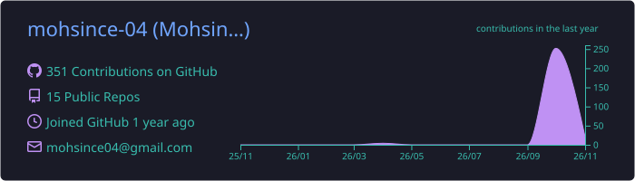
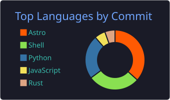

  <!-- Animated Typing Header -->
  

  

    <b>Bridging AI Agent Workflows & Low-Level Systems: Rust, C++, Python, LLM Inference & High-Performance Pipelines.</b>
  

  

    <em>Exploring how AI and software work behind the scenes, from building intelligent tools that can think and take action to creating the fast, reliable systems that make them possible, using Rust, C++, and Python.</em>
  

---

- **LLM Inference & Runtimes:** Local model execution, GGUF quantization/parsing, memory-mapped tensor operations, and low-latency token generation.  <em>Running AI models locally, understanding how they work behind the scenes, making them smaller and more efficient, and improving how quickly they generate responses without relying entirely on cloud-based services.</em>
- **Systems Engineering:** Zero-cost abstractions, manual memory management, concurrency, and high-throughput async backends in **Rust** and **C++**.  <em>Building fast, reliable, and efficient software with Rust and C++, understanding how computers manage memory, handle multiple tasks at once, and process large amounts of work without wasting resources.</em>
- **AI Agent Workflows:** Autonomous tool-use pipelines, RAG architectures, structured outputs, and CLI/daemon-driven developer tooling.  <em>Building AI tools that can understand tasks, find useful information, use other tools, and carry out work on their own, along with creating smarter ways to search through information and automate everyday development tasks.</em>
- **High-Performance Pipelines:** Streaming data ingestion, hardware-accelerated media/audio processing, and minimal-overhead Linux environments.  <em>Building systems that can handle large amounts of information quickly and efficiently, processing audio and video using computer hardware, and keeping Linux environments lightweight, fast, and free from unnecessary overhead.</em>

---

**Systems & Languages**  

**AI, Inference & Data**  

**Infrastructure & Environment**  

---

  
  

 

  <!-- Streak Stats -->
  

 

  <!-- Contribution Activity Graph -->
  

---

<!-- Note: Requires the GitHub Action workflow below to generate the SVG -->

  <picture>
    <source media="(prefers-color-scheme: dark)" srcset="https://raw.githubusercontent.com/mohsince-04/mohsince-04/output/github-contribution-grid-snake-dark.svg" />
    <source media="(prefers-color-scheme: light)" srcset="https://raw.githubusercontent.com/mohsince-04/mohsince-04/output/github-contribution-grid-snake.svg" />
    
  </picture>

